# AI-Based State-Wise Widowed and Divorced Women Population Analysis Using Machine Learning

## 📌 Project Overview

This project presents an AI-based system for analyzing the state-wise population of widowed and divorced women in India using Machine Learning (ML), Artificial Immune System (AIS), and Particle Swarm Optimization (PSO).

The project focuses on identifying demographic patterns, analyzing statistical relationships, and estimating divorced-women population counts using regression models.

The system implements multiple machine learning algorithms and applies bio-inspired optimization techniques to improve model hyperparameter selection.

The project also generates graphical visualizations, prediction reports, model comparison graphs, and evaluation metrics.

### Key Features

- State-wise demographic population analysis
- Machine Learning-based population estimation
- Artificial Immune System (AIS) optimization
- Particle Swarm Optimization (PSO)
- Random Forest hyperparameter optimization
- Statistical correlation analysis
- Model performance evaluation
- Actual vs predicted population comparison
- Automated CSV report generation
- High-resolution graphical visualizations
- Model serialization using PKL and H5
- Configuration storage using JSON and YAML

---

# 🎯 Project Objectives

The primary objectives of this project are:

1. Analyze state-wise populations of widowed and divorced women in India.
2. Identify demographic patterns across states and union territories.
3. Examine relationships between widowhood and divorce counts.
4. Develop machine learning models for estimating divorced-women population counts.
5. Evaluate regression models using standard performance metrics.
6. Optimize Random Forest hyperparameters using Artificial Immune System.
7. Optimize Random Forest hyperparameters using Particle Swarm Optimization.
8. Compare conventional machine learning models with AIS- and PSO-optimized models.
9. Generate graphical visualizations of demographic patterns.
10. Produce prediction reports for demographic analysis.

---

# 📊 Dataset Description

## Dataset Name

`RS_Session_259_AU_3352_A_and_B.csv`

The dataset contains state-wise information about widowed and divorced women in India.

## Dataset Features

| Attribute | Description | Data Type |
|---|---|---|
| State/ UT | Name of Indian state or union territory | Categorical |
| Female of all Ages - Widowed | Number of widowed women | Numerical |
| Female of all Ages - Divorced | Number of divorced women | Numerical |

## Dataset Information

| Property | Description |
|---|---|
| Dataset Type | Demographic Population Data |
| Geographic Coverage | Indian States and Union Territories |
| Number of Records | Approximately 36 |
| Number of Original Columns | 3 |
| Prediction Type | Regression |
| Main Input Variable | Widowed Women Population |
| Target Variable | Divorced Women Population |
| Output | Estimated Divorced Women Population |

## Input and Output Variables

### Input Variable

```python
X = df[["Female of all Ages - Widowed"]]
```

### Target Variable

```python
y = df["Female of all Ages - Divorced"]
```

State names are retained for reporting and visualization.

The standard ML implementation also explores categorical state encoding, while AIS and PSO use the widowed population as the numerical predictor.

---

# 🛠️ Technologies Used

## Programming Language

- Python 3.10+

## Libraries and Frameworks

| Library | Purpose |
|---|---|
| Pandas | Data loading and manipulation |
| NumPy | Numerical computations |
| Matplotlib | Graphical visualization |
| Seaborn | Statistical visualization |
| Scikit-learn | Machine learning algorithms |
| TensorFlow | Deep learning model development |
| Joblib | Model serialization |
| PyYAML | YAML configuration files |
| JSON | Model metadata storage |
| H5py | HDF5 file generation |

---

# 🤖 Machine Learning Algorithms

The project implements the following regression algorithms.

## 1. Linear Regression

Linear Regression establishes a mathematical relationship between input and target variables.

### Mathematical Formula

\[
Y = \beta_0 + \beta_1X
\]

Where:

- Y = Predicted divorced-women population
- X = Widowed-women population
- β₀ = Intercept
- β₁ = Regression coefficient

### Advantages

- Simple implementation
- Computationally efficient
- Easy interpretation
- Useful as a baseline model

---

## 2. Decision Tree Regressor

Decision Tree Regression divides the dataset into smaller subsets based on feature values.

### Advantages

- Handles nonlinear relationships
- Easy to visualize
- Requires limited feature scaling
- Supports numerical prediction

---

## 3. Random Forest Regressor

Random Forest is an ensemble learning algorithm that combines multiple decision trees.

### Mathematical Formula

\[
\hat{Y} = \frac{1}{N}\sum_{i=1}^{N}T_i(X)
\]

Where:

- N = Number of decision trees
- Tᵢ(X) = Prediction from the ith tree
- Ŷ = Final predicted value

### Advantages

- Handles nonlinear relationships
- Reduces variance compared with individual trees
- Supports hyperparameter optimization
- Useful for tabular regression problems

---

## 4. Gradient Boosting Regressor

Gradient Boosting combines weak learners sequentially to minimize prediction errors.

### Mathematical Formula

\[
F_m(X) = F_{m-1}(X) + \eta h_m(X)
\]

Where:

- Fₘ(X) = Updated prediction
- η = Learning rate
- hₘ(X) = New weak learner

### Advantages

- Learns complex relationships
- Supports nonlinear regression
- Offers configurable model complexity

---

## 5. Support Vector Regression

Support Vector Regression attempts to fit a function while controlling prediction errors.

### Advantages

- Supports nonlinear kernels
- Useful for smaller datasets
- Provides regularization controls

---

# 🧬 Artificial Immune System (AIS)

## Overview

Artificial Immune System is a bio-inspired optimization technique based on principles of the biological immune system.

This project implements a Clonal Selection Algorithm (CLONALG) to optimize Random Forest hyperparameters.

## AIS Optimization Process

1. Initialize antibody population.
2. Evaluate antibody fitness.
3. Select high-performing antibodies.
4. Clone selected antibodies.
5. Apply hypermutation.
6. Evaluate mutated antibodies.
7. Replace weaker antibodies.
8. Repeat until the maximum generation count is reached.

## AIS Configuration

| Parameter | Value |
|---|---|
| Population Size | 12 |
| Generations | 20 |
| Clone Factor | 4 |
| Elite Count | 4 |
| Random Replacements | 3 |
| Mutation Rate | 0.30 |
| Cross-Validation Folds | 5 |

## Hyperparameters Optimized

| Hyperparameter | Minimum | Maximum |
|---|---:|---:|
| n_estimators | 30 | 200 |
| max_depth | 2 | 15 |
| min_samples_split | 2 | 12 |
| min_samples_leaf | 1 | 6 |

## AIS Fitness Function

The AIS algorithm minimizes cross-validation Mean Absolute Error.

\[
Fitness = \frac{1}{K}\sum_{i=1}^{K}MAE_i
\]

Where:

- K = Number of cross-validation folds
- MAE = Mean Absolute Error

Lower fitness values indicate better cross-validation performance.

## AIS Output Files

```text
ais_model.pkl
ais_model.h5
ais_model.yaml
ais_model.json

ais_accuracy_graph.png
ais_heatmap.png
ais_comparison_graph.png

ais_result.csv
ais_result_graph.png

ais_prediction.csv
ais_prediction_graph.png
```

---

# 🐦 Particle Swarm Optimization (PSO)

## Overview

Particle Swarm Optimization is a population-based optimization algorithm inspired by the collective movement of birds and fish.

Each particle represents a candidate combination of Random Forest hyperparameters.

Particles update their positions based on their individual best solutions and the global best solution.

## PSO Optimization Process

1. Initialize particle positions.
2. Initialize particle velocities.
3. Evaluate particle fitness.
4. Update personal best positions.
5. Update global best position.
6. Calculate new velocities.
7. Update particle positions.
8. Repeat until the maximum iteration count is reached.

## PSO Configuration

| Parameter | Value |
|---|---|
| Number of Particles | 12 |
| Maximum Iterations | 20 |
| Inertia Weight | 0.7 |
| Cognitive Coefficient | 1.5 |
| Social Coefficient | 1.5 |
| Cross-Validation Folds | 5 |

## PSO Velocity Update Formula

\[
v_i^{t+1} = wv_i^t + c_1r_1(pbest_i-x_i^t) + c_2r_2(gbest-x_i^t)
\]

Where:

- w = Inertia weight
- c₁ = Cognitive coefficient
- c₂ = Social coefficient
- r₁, r₂ = Random values between 0 and 1
- pbest = Personal best position
- gbest = Global best position

## PSO Position Update Formula

\[
x_i^{t+1} = x_i^t + v_i^{t+1}
\]

## PSO Fitness Function

\[
Fitness = \frac{1}{K}\sum_{i=1}^{K}MAE_i
\]

The objective is to minimize cross-validation MAE.

## PSO Output Files

```text
pso_model.pkl
pso_model.h5
pso_model.yaml
pso_model.json

pso_accuracy_graph.png
pso_heatmap.png
pso_comparison_graph.png

pso_result.csv
pso_result_graph.png

pso_prediction.csv
pso_prediction_graph.png
```

---

# 📈 Model Evaluation Metrics

The performance of regression models is evaluated using the following metrics.

## 1. Mean Absolute Error (MAE)

\[
MAE = \frac{1}{n}\sum_{i=1}^{n}|y_i-\hat{y}_i|
\]

MAE measures the average absolute difference between actual and predicted values.

**Lower MAE indicates better performance.**

## 2. Mean Squared Error (MSE)

\[
MSE = \frac{1}{n}\sum_{i=1}^{n}(y_i-\hat{y}_i)^2
\]

MSE penalizes larger prediction errors more heavily.

**Lower MSE indicates better performance.**

## 3. Root Mean Squared Error (RMSE)

\[
RMSE = \sqrt{\frac{1}{n}\sum_{i=1}^{n}(y_i-\hat{y}_i)^2}
\]

RMSE measures prediction error in the same units as the target variable.

**Lower RMSE indicates better performance.**

## 4. R-Squared Score

\[
R^2 = 1-\frac{\sum(y_i-\hat{y}_i)^2}{\sum(y_i-\bar{y})^2}
\]

R² measures how well the regression model explains variation in the target variable.

**Higher R² generally indicates better regression performance.**

R² can be negative when the model performs worse than a mean-based baseline.

---

# 📊 Data Visualization

The project generates several visualizations for analyzing demographic patterns and model performance.

## 1. Machine Learning Performance Graph

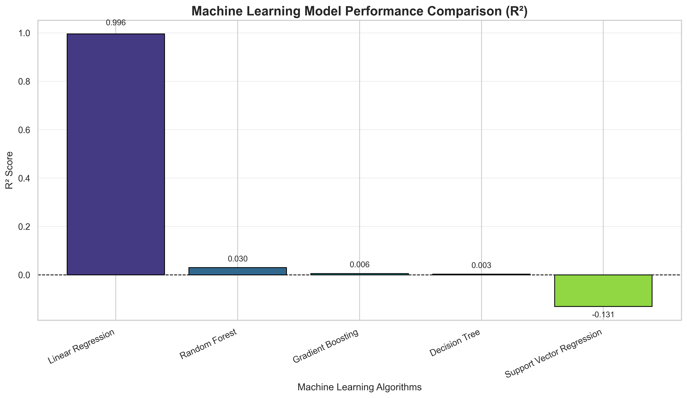

**Figure 1: Machine Learning Model Performance Comparison**

The graph compares regression models using R² scores.

It helps identify which model performs better on the test dataset.

Because this is a regression project, the graph represents R² rather than classification accuracy.

---

## 2. Correlation Heatmap

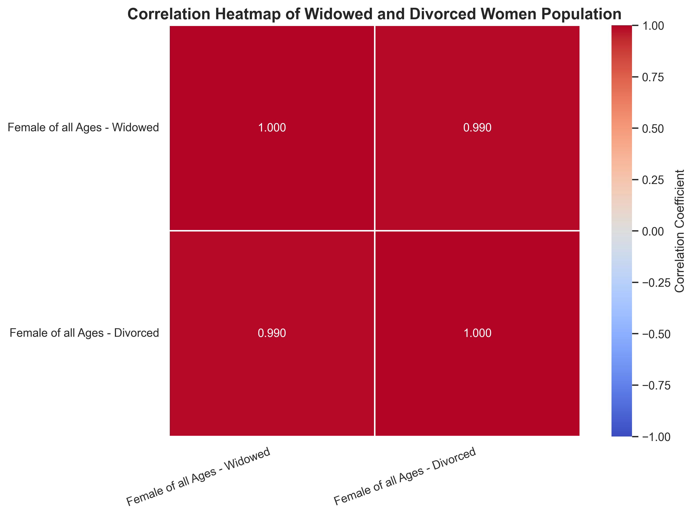

**Figure 2: Correlation Between Widowed and Divorced Women Population**

The heatmap displays the correlation coefficient between the numerical demographic variables.

It helps identify the strength and direction of their statistical relationship.

Correlation does not imply causation.

---

## 3. Machine Learning Model Comparison

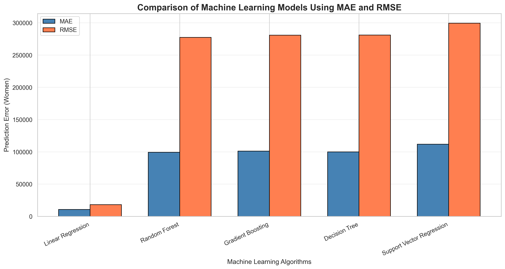

**Figure 3: Machine Learning Algorithm Comparison**

The graph compares machine learning algorithms using:

- Mean Absolute Error
- Root Mean Squared Error

Lower error values indicate better performance.

---

## 4. Actual vs Predicted Population

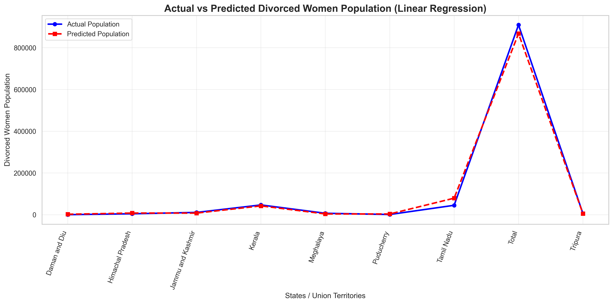

**Figure 4: Actual vs Predicted Divorced Women Population**

The graph compares actual population counts with model predictions on held-out test records.

---

## 5. State-Wise Population Predictions

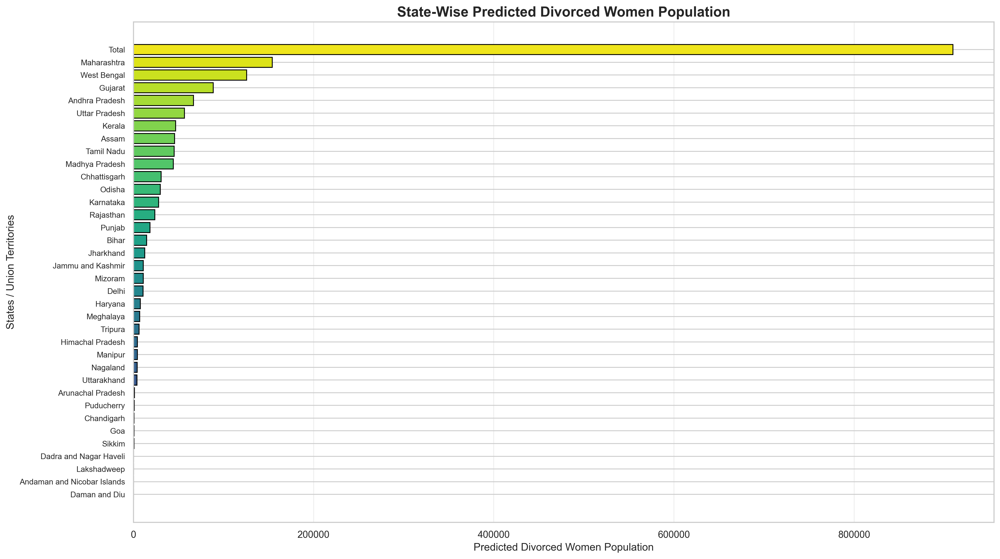

**Figure 5: State-Wise Estimated Divorced Women Population**

The graph visualizes fitted estimates generated by the final model.

These estimates are not forecasts for future years.

---

# 🧬 AIS Visualizations

## AIS Optimization Convergence

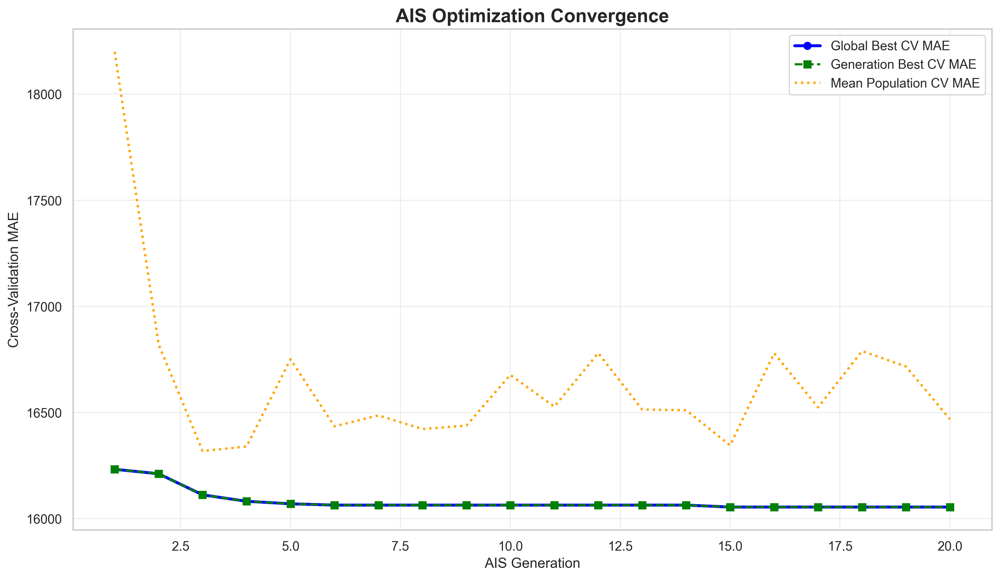

The graph displays the change in cross-validation MAE across AIS generations.

## AIS Correlation Heatmap


The graph displays correlations between demographic variables.

## AIS Model Comparison

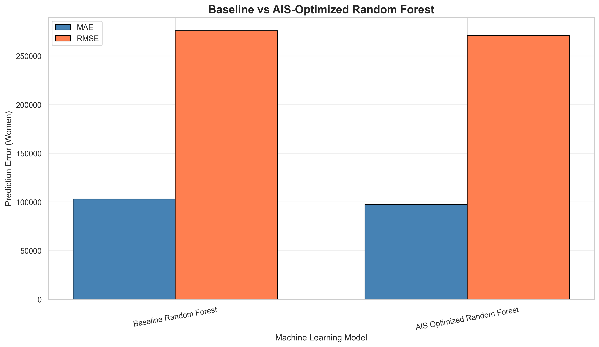

The graph compares baseline Random Forest and AIS-optimized Random Forest.

## AIS Actual vs Predicted Results

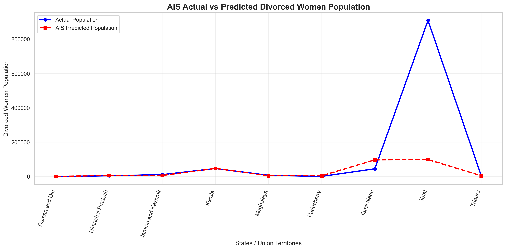

The graph displays actual and predicted values on held-out test records.

## AIS State-Wise Predictions


The graph displays fitted state-wise population estimates.

---

# 🐦 PSO Visualizations

## PSO Optimization Convergence

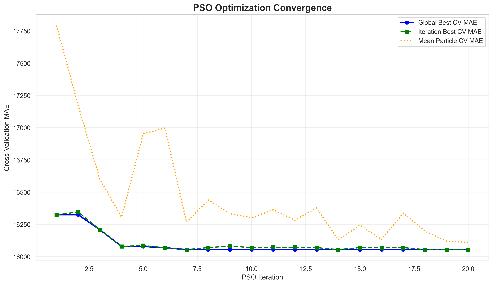

The graph shows the optimization progress of PSO across iterations.

## PSO Correlation Heatmap

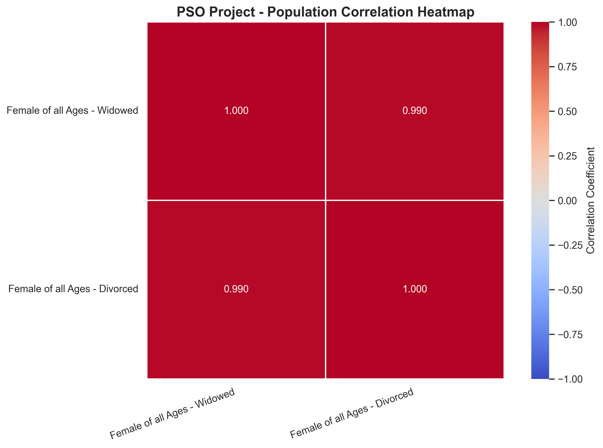

The graph displays statistical correlations between demographic variables.

## PSO Model Comparison


The graph compares baseline Random Forest and PSO-optimized Random Forest.

## PSO Actual vs Predicted Results


The graph displays actual and predicted values on held-out test records.

## PSO State-Wise Predictions

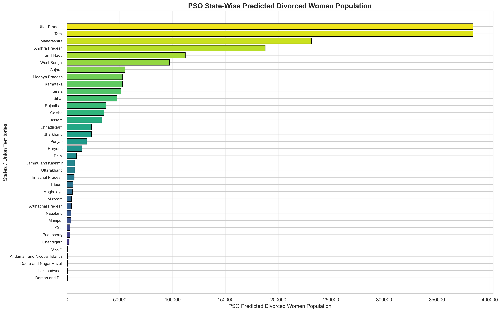

The graph displays fitted population estimates generated by the PSO-optimized model.

---

# 📁 Project Directory Structure

```text
AI-Based State-Wise Widowed and Divorced Women Population Analysis/
│
├── RS_Session_259_AU_3352_A_and_B.csv
│
├── main.py
├── visualization.py
├── ais_model.py
├── pso_model.py
│
├── model.h5
├── model.pkl
├── model.yaml
├── model.json
├── dl_preprocessing.pkl
│
├── accuracy_graph.png
├── heatmap.png
├── comparison_graph.png
├── result.csv
├── result_graph.png
├── prediction.csv
├── prediction_graph.png
│
├── ais_model.pkl
├── ais_model.h5
├── ais_model.yaml
├── ais_model.json
│
├── ais_accuracy_graph.png
├── ais_heatmap.png
├── ais_comparison_graph.png
├── ais_result.csv
├── ais_result_graph.png
├── ais_prediction.csv
├── ais_prediction_graph.png
│
├── pso_model.pkl
├── pso_model.h5
├── pso_model.yaml
├── pso_model.json
│
├── pso_accuracy_graph.png
├── pso_heatmap.png
├── pso_comparison_graph.png
├── pso_result.csv
├── pso_result_graph.png
├── pso_prediction.csv
├── pso_prediction_graph.png
│
└── README.md
```

---

# ⚙️ Installation and Setup

## Step 1: Install Python

Install Python 3.10 or a compatible version.

Verify the installation:

```bash
python --version
```

## Step 2: Install Required Libraries

```bash
pip install pandas numpy matplotlib seaborn scikit-learn tensorflow joblib pyyaml h5py
```

## Step 3: Open Project Directory

Open the project folder in Visual Studio Code.

Alternatively, use the terminal:

```powershell
cd "C:\Users\sagni\Downloads\AI-Based State-Wise Widowed and Divorced Women Population Analysis"
```

## Step 4: Verify Dataset

Ensure the following dataset exists:

```text
RS_Session_259_AU_3352_A_and_B.csv
```

The dataset should be placed in the project directory.

---

# 🚀 How to Run the Project

## 1. Train Machine Learning Models

```bash
python main.py
```

This script:

- Loads the dataset
- Performs preprocessing
- Trains machine learning models
- Evaluates model performance
- Trains a neural network
- Saves model files

### Generated Model Files

```text
model.h5
model.pkl
model.yaml
model.json
dl_preprocessing.pkl
```

---

## 2. Generate Machine Learning Visualizations

```bash
python visualization.py
```

This script generates:

```text
accuracy_graph.png
heatmap.png
comparison_graph.png
result.csv
result_graph.png
prediction.csv
prediction_graph.png
```

---

## 3. Run Artificial Immune System

```bash
python ais_model.py
```

This script:

- Initializes AIS antibodies
- Evaluates antibody fitness
- Performs clonal selection
- Applies hypermutation
- Optimizes Random Forest hyperparameters
- Generates evaluation results
- Saves AIS model files
- Displays and saves AIS graphs

---

## 4. Run Particle Swarm Optimization

```bash
python pso_model.py
```

This script:

- Initializes PSO particles
- Evaluates particle fitness
- Updates personal best positions
- Updates global best position
- Optimizes Random Forest hyperparameters
- Generates evaluation results
- Saves PSO model files
- Displays and saves PSO graphs

---

# 💾 Model Files

## Standard Machine Learning Model

| File | Description |
|---|---|
| model.pkl | Best machine learning regression pipeline |
| model.h5 | Trained neural network |
| model.yaml | Configuration and evaluation metrics |
| model.json | Model architecture and evaluation details |
| dl_preprocessing.pkl | Neural-network preprocessing objects |

## AIS Model

| File | Description |
|---|---|
| ais_model.pkl | AIS-optimized Random Forest |
| ais_model.h5 | AIS optimization metadata and history |
| ais_model.yaml | AIS configuration |
| ais_model.json | AIS results and model information |

## PSO Model

| File | Description |
|---|---|
| pso_model.pkl | PSO-optimized Random Forest |
| pso_model.h5 | PSO optimization metadata and history |
| pso_model.yaml | PSO configuration |
| pso_model.json | PSO results and model information |

---

# 📋 Prediction Reports

## Standard Machine Learning

### result.csv

Contains:

- State/UT
- Widowed population
- Actual divorced population
- Predicted divorced population
- Absolute error
- Percentage error

### prediction.csv

Contains state-wise fitted population estimates generated using the final trained model.

---

## AIS Prediction Reports

### ais_result.csv

Contains held-out test results generated by the AIS-optimized model.

### ais_prediction.csv

Contains state-wise fitted estimates generated by the final AIS-optimized model.

---

## PSO Prediction Reports

### pso_result.csv

Contains held-out test results generated by the PSO-optimized model.

### pso_prediction.csv

Contains state-wise fitted estimates generated by the final PSO-optimized model.

---

# 🔬 Comparative Analysis

The project supports comparison between standard machine learning, AIS optimization, and PSO optimization.

| Parameter | Standard ML | AIS | PSO |
|---|---|---|---|
| Regression | Yes | Yes | Yes |
| Random Forest | Yes | Yes | Yes |
| Bio-Inspired Optimization | No | Yes | Yes |
| Hyperparameter Optimization | Not explicitly implemented | Clonal Selection | Particle Swarm |
| Cross-Validation | Yes | Yes | Yes |
| MAE Evaluation | Yes | Yes | Yes |
| RMSE Evaluation | Yes | Yes | Yes |
| R² Evaluation | Yes | Yes | Yes |
| Prediction CSV | Yes | Yes | Yes |
| Visualization | Yes | Yes | Yes |
| Model Serialization | Yes | Yes | Yes |

## Comparison Methodology

For a fair experimental comparison:

1. Use the same cleaned dataset.
2. Use the same input features.
3. Use the same training and testing split.
4. Use the same evaluation metrics.
5. Use cross-validation for hyperparameter selection.
6. Evaluate final models on held-out test data.
7. Compare prediction errors and computational costs.

AIS and PSO do not guarantee improvements over the baseline model.

---

# 🔄 Project Workflow

```text
                  START
                    |
                    v
              Load Dataset
                    |
                    v
             Data Cleaning
                    |
                    v
           Feature Preparation
                    |
                    v
             Train-Test Split
                    |
                    v
          Machine Learning Models
                    |
          +---------+---------+
          |                   |
          v                   v
     Standard ML       Optimization
          |                   |
          |             +-----+-----+
          |             |           |
          |             v           v
          |            AIS         PSO
          |             |           |
          |             v           v
          |        Clonal       Particle
          |        Selection    Swarm
          |             |           |
          |             v           v
          |         Optimized   Optimized
          |         Random      Random
          |         Forest      Forest
          |             |           |
          +-------------+-----------+
                        |
                        v
                Model Evaluation
                        |
                        v
               Generate Predictions
                        |
                        v
               Generate CSV Reports
                        |
                        v
                Create Visualizations
                        |
                        v
                 Save Model Files
                        |
                        v
                       END
```

---

# 📌 Expected Outcomes

The project is designed to produce:

1. State-wise demographic population analysis.
2. Statistical relationships between widowhood and divorce counts.
3. Regression-based estimates of divorced-women population.
4. Comparative evaluation of machine learning algorithms.
5. AIS-based Random Forest hyperparameter optimization.
6. PSO-based Random Forest hyperparameter optimization.
7. Graphical comparison of model performance.
8. Actual versus predicted population reports.
9. State-wise fitted prediction visualizations.
10. Reusable trained models and configuration files.

Actual model performance depends on the dataset and experimental results.

---

# ⚠️ Limitations

## 1. Small Dataset

The dataset contains approximately 36 observations.

This limits the reliability and generalization ability of machine learning models.

## 2. Limited Input Features

The AIS and PSO models primarily use widowed-women population counts to estimate divorced-women population counts.

Other demographic variables are not included.

## 3. No Time-Series Information

The dataset does not contain a sequence of yearly observations.

Therefore, the models cannot reliably forecast future population changes.

## 4. Population Size Effects

States with larger overall populations may have higher counts of both widowed and divorced women.

A correlation between the counts does not necessarily indicate a direct demographic relationship.

## 5. Model Overfitting

Complex models may overfit because of the limited number of training observations.

## 6. Optimization Limitations

AIS and PSO can improve hyperparameter selection but cannot guarantee better generalization performance.

---

# 🔮 Future Scope

Future improvements may include:

- Integration of historical census datasets
- State-wise population forecasting using time-series models
- Additional demographic features
- Age-group-specific demographic analysis
- Rural and urban population comparisons
- Population-normalized demographic rates
- Geographic visualization using interactive maps
- Explainable AI techniques
- SHAP-based feature importance analysis
- Advanced ensemble learning
- Bayesian hyperparameter optimization
- Interactive dashboards using Streamlit
- Automated report generation
- Integration with public demographic databases

---

# 🌍 Applications

## Demographic Research

Supports exploratory analysis of demographic patterns across Indian states.

## Social Science Research

Provides statistical tools for examining widowhood and divorce population distributions.

## Academic Research

Demonstrates applications of machine learning and bio-inspired optimization algorithms.

## Data Analytics

Provides a reproducible workflow for preprocessing, modeling, evaluation, and visualization.

## Educational Applications

Can be used as a practical project for:

- Machine Learning
- Artificial Intelligence
- Data Science
- Data Analytics
- Optimization Algorithms
- Python Programming

---

# 📝 Research Methodology

The research methodology consists of five major stages.

### Stage 1: Data Collection

The demographic dataset is obtained in CSV format.

### Stage 2: Data Preprocessing

Data preprocessing includes:

- Removing duplicate records
- Handling missing values
- Converting numerical columns
- Preparing input features
- Splitting training and testing data

### Stage 3: Model Development

Multiple regression algorithms are trained to estimate divorced-women population counts.

### Stage 4: Model Optimization

AIS and PSO optimize Random Forest hyperparameters using cross-validation MAE.

### Stage 5: Model Evaluation

Models are evaluated using MAE, MSE, RMSE, and R².

The results are visualized and saved as CSV reports and PNG graphs.

---

# 📚 References

1. Breiman, L. (2001). Random Forests. Machine Learning, 45, 5–32.
2. Kennedy, J., & Eberhart, R. (1995). Particle Swarm Optimization. Proceedings of IEEE International Conference on Neural Networks.
3. de Castro, L. N., & Von Zuben, F. J. (2002). Learning and Optimization Using the Clonal Selection Principle. IEEE Transactions on Evolutionary Computation.
4. Pedregosa, F., et al. (2011). Scikit-learn: Machine Learning in Python. Journal of Machine Learning Research.
5. Chollet, F., et al. Keras: Deep Learning for Humans.
6. McKinney, W. (2010). Data Structures for Statistical Computing in Python.

---

# 📜 Conclusion

The **AI-Based State-Wise Widowed and Divorced Women Population Analysis Using Machine Learning** project demonstrates the application of regression algorithms and bio-inspired optimization techniques to demographic data.

The project integrates conventional machine learning models with Artificial Immune System and Particle Swarm Optimization to investigate whether hyperparameter optimization improves predictive performance.

It also provides statistical visualizations, model evaluation metrics, prediction reports, and reusable model artifacts.

Although the small dataset limits the reliability of population estimates, the project provides a practical framework for exploratory demographic analysis, machine learning experimentation, and comparative optimization research.

---

# ⭐ Project Summary

**Project Title:** AI-Based State-Wise Widowed and Divorced Women Population Analysis Using Machine Learning

**Domain:** Artificial Intelligence and Machine Learning

**Programming Language:** Python

**Machine Learning Type:** Supervised Regression

**Optimization Algorithms:** Artificial Immune System (AIS) and Particle Swarm Optimization (PSO)

**Primary Model:** Random Forest Regressor

**Dataset:** State-Wise Widowed and Divorced Women Population Data

**Evaluation Metrics:** MAE, MSE, RMSE, R²

**Outputs:** Trained Models, CSV Reports, Performance Graphs, and Population Visualizations

---

## ⭐ Support

If you find this project useful, consider giving the repository a star.

Contributions, improvements, and suggestions are welcome.

---

**Developed using Python, Machine Learning, Artificial Immune System, and Particle Swarm Optimization.**
